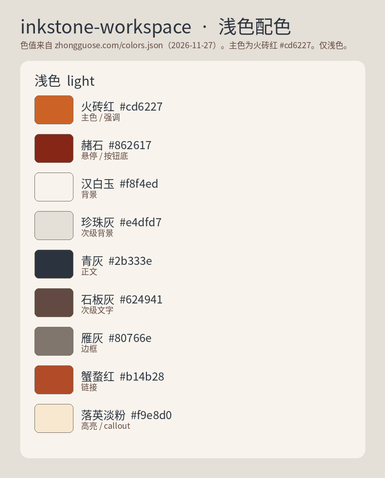

# Obsidian 简 / 繁中文起始库

开箱即可用的 Obsidian starter vault，面向考古笔记工作流：导入报告 → 转成 Markdown → 抽取墓葬 → 补遗址 / 器物笔记。

仓库：[alexxhchen-nu/inkstone-workspace](https://github.com/alexxhchen-nu/inkstone-workspace)。本仓库是独立起始库，不是 [alexxhchen-nu/untangle](https://github.com/alexxhchen-nu/untangle) 的应用代码。自研插件来自 Untangle，只在下方致谢和 [NOTICE.md](NOTICE.md) 里引用。

## 怎么打开

不要用「打开仓库根目录」。分别打开下面其中一个文件夹，作为独立的库：

1. 简体中文：`vault/zh-Hans/`
2. 繁体中文：`vault/zh-Hant/`

在 Obsidian 里：打开文件夹作为库（Open folder as vault）→ 选上面那个路径。第一次打开会看到首页 `Start Here`。

更短的步骤在库内的 `快速上手.md`，插件说明在库内的 `README.md`。

## 里面有什么

每个语言变体都有同一套文件夹和模板（路径相同，正文语言不同）：

| 路径 | 用途 |
| --- | --- |
| `Start Here.md` | 唯一首页，带下一步 |
| `Templates/` | 新笔记、报告、墓葬、遗址、器物 |
| `Inbox/` | 报告原文（PDF / Office / 图片 / Markdown） |
| `Parsed/` | 文档解析得到的 Markdown |
| `Tombs/` | 抽取后的墓葬数据 |
| `Sites/` | 遗址笔记 |
| `Artifacts/` | 器物笔记 |
| `Attachments/` | 图片和附件 |

## 插件

已经打包进库、打开即可用：

- **Archaeo Doc Parser**（MIT，来自 Untangle）：把 PDF / 图片 / Office 转成 Markdown。免费档不用填 MinerU token，也不要把 token 写进库。
- **Archaeological Tomb Parser**（MIT，来自 Untangle）：从中文报告里抽取墓葬数据，导出 JSON / CSV / Markdown。
- **Templater**（AGPL-3.0）：插入模板；也可只用核心「模板」插件。
- **Style Settings**（GPL-3.0）：用来开 Still 主题的「中文排版」等选项。本库默认已打开中文排版。
- 主题 **Still**（MIT，letschips）：带 CJK 排版选项。

来源、版本和许可证写在 [NOTICE.md](NOTICE.md)。不要在这个库里保存任何 API key。

## 先试一条命令

两个库的 `Inbox/示例墓葬文本.md` 里有一份合成示例（不是真实发掘报告）。打开它，命令面板运行 **Parse archaeological tombs**，应能抽出 M1。

解析插件按简体关键词识别形制和尺寸（例如「土坑竖穴墓」「长 2.5 米」），所以示例正文在两个库里都保持简体，好让这条命令都能跑通。


## 配色

主色用中国传统色 **火砖红** `#cd6227`。色值来自 [zhongguose.com 的 colors.json](https://zhongguose.com/colors.json)（2026-11-27 读取，共 526 色）。官网：[中国色](https://zhongguose.com/)。色库里没有名为「砖红」的条目，火砖红是对应的砖红色（拼音 `huozhuanhong`，RGB 205, 98, 39）。

配色写在两个库的 `.obsidian/snippets/inkstone-palette.css`，并已在 `appearance.json` 里启用。基础主题固定为 Obsidian 浅色（`moonstone`），本库不用深色方案。预览：



| 色名 | Hex | 角色 | 正文对比度 |
| --- | --- | --- | --- |
| 火砖红 | `#cd6227` | 主色 / 强调 | 对汉白玉 3.57:1（大号字 / 控件，不够小字正文） |
| 赭石 | `#862617` | 悬停、实心按钮底 | 对汉白玉 8.32:1 AAA；雪白字在赭石上 9.03:1 AAA |
| 汉白玉 | `#f8f4ed` | 背景 | — |
| 珍珠灰 | `#e4dfd7` | 次级背景 | — |
| 青灰 | `#2b333e` | 正文 | 对汉白玉 11.64:1 AAA |
| 石板灰 | `#624941` | 次级文字 | 对汉白玉 7.52:1 AAA；对珍珠灰 6.21:1 AA |
| 雁灰 | `#80766e` | 边框 | 对汉白玉 4.05:1（控件 3:1） |
| 蟹蝥红 | `#b14b28` | 链接 | 对汉白玉 4.90:1 AA（因此小字链接不用火砖红） |
| 落英淡粉 | `#f9e8d0` | 高亮 / callout | 青灰字在其上 10.62:1 AAA |

## 检查

在仓库根目录：

```bash
python3 scripts/check_starter_vaults.py
bun scripts/check_sample_tomb_parse.ts
```

检查项：`.obsidian` 里的 JSON 能解析；`community-plugins.json` 列出的插件都有目录和 `manifest.json`；模板是合法 Markdown 且 frontmatter 完整；内部 `[[链接]]` 能解析；简 / 繁路径对齐；仓库里没有密钥。第二条会用捆绑的墓葬解析器跑那份示例文本。

## 许可证

本仓库原创内容（说明、模板、配置和检查脚本）使用 [MIT License](LICENSE)，Copyright (c) 2026 Alex Chen。GROK-61 卡片没有指定仓库许可证，这是为公开仓库作的默认选择，如需更换可在审阅时改。

捆绑的第三方和 Untangle 插件保留各自许可证，见 [NOTICE.md](NOTICE.md)。Untangle 应用本身尚未选择开源许可证；其中两个自研插件的 README / LICENSE 写明为 MIT。

## 致谢

- [alexxhchen-nu/untangle](https://github.com/alexxhchen-nu/untangle)：Archaeo Doc Parser、Archaeological Tomb Parser，以及示例解析所用的 `tomb_parser.ts`
- [SilentVoid13/Templater](https://github.com/SilentVoid13/Templater)
- [obsidian-community/obsidian-style-settings](https://github.com/obsidian-community/obsidian-style-settings)
- [letschips/obsidian-still](https://github.com/letschips/obsidian-still)
- [中国色 zhongguose.com](https://zhongguose.com/)：传统色色值（`colors.json`）
