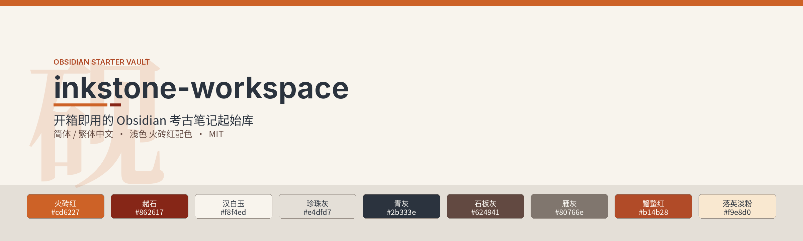

# inkstone-workspace

<p align="center">
  
</p>

<p align="center">
  <a href="LICENSE"></a>
  <a href="https://github.com/alexxhchen-nu/inkstone-workspace/actions/workflows/starter-vault.yml"></a>
</p>

开箱即用的 Obsidian 考古笔记起始库，同时提供简体（`vault/zh-Hans`）和繁体（`vault/zh-Hant`）两个平行库：导入报告 → 转成 Markdown → 抽取墓葬 → 补遗址 / 器物笔记。

本仓库是独立起始库，不是 [alexxhchen-nu/untangle](https://github.com/alexxhchen-nu/untangle) 的应用代码。自研插件来自 Untangle，只在下方致谢和 [NOTICE.md](NOTICE.md) 里引用。

## 目录

- [快速上手](#快速上手)
- [两个语言库](#两个语言库)
- [文件夹与工作流](#文件夹与工作流)
- [捆绑插件](#捆绑插件)
  - [Archaeo Doc Parser](#archaeo-doc-parser)
  - [Archaeological Tomb Parser](#archaeological-tomb-parser)
  - [Templater](#templater)
  - [Style Settings](#style-settings)
  - [Still 主题](#still-主题)
- [核心插件](#核心插件)
- [模板](#模板)
- [配色](#配色)
- [检查脚本与 CI](#检查脚本与-ci)
- [许可证](#许可证)
- [致谢](#致谢)
- [常见问题](#常见问题)

## 快速上手

只需三步：

1. **打开其中一个库，不要打开仓库根目录。** 在 Obsidian 里选「打开文件夹作为库」（Open folder as vault），选 `vault/zh-Hans/`（简体）或 `vault/zh-Hant/`（繁体）。第一次打开会看到首页 `Start Here`。
2. **确认打包插件已启用。** 设置 → 第三方插件：Archaeo Doc Parser、Archaeological Tomb Parser、Templater、Style Settings 应为开启。设置 → 外观：主题为 **Still**，基础颜色为浅色（`moonstone`），CSS 片段 `inkstone-palette` 已启用。
3. **用示例跑通抽取命令。** 打开 `Inbox/示例墓葬文本.md`，命令面板运行 **Parse archaeological tombs (current file)**。结果应出现在 `Tombs/示例墓葬文本_tombs/`，并抽出 M1（土坑竖穴墓，墓口长 2.5 米、宽 1.2 米、深 3.0 米）。

库内还有更细的步骤：`快速上手.md` 和 `Start Here.md`。

## 两个语言库

两个库的文件夹、模板文件名、插件、主题、CSS 片段和配置键是对齐的；笔记正文和库内说明分别用简体或繁体。

| 库 | 路径 | 说明语言 |
| --- | --- | --- |
| 简体中文 | [`vault/zh-Hans/`](vault/zh-Hans/) | 简体 |
| 繁体中文 | [`vault/zh-Hant/`](vault/zh-Hant/) | 繁体 |

例外：两个库的 `Inbox/示例墓葬文本.md` 正文都保持简体。捆绑的墓葬解析器按简体关键词识别形制和尺寸（例如「土坑竖穴墓」），这样才能让同一条命令在两个库里都跑通。这不是真实发掘报告，只用来试命令。

## 文件夹与工作流

建议路径：

```text
Inbox（报告原文）
  → Archaeo Doc Parser → Parsed（Markdown）
    → Archaeological Tomb Parser → Tombs/<源文件名>_tombs/（JSON / CSV / Markdown）
      → 用模板补 Sites（遗址）和 Artifacts（器物）
```

| 路径 | 用途 |
| --- | --- |
| `Start Here.md` | 唯一首页，带下一步 |
| `快速上手.md` | 库内短步骤 |
| `README.md` | 库内插件与工作流说明 |
| `Templates/` | 新笔记、报告、墓葬、遗址、器物五个模板 |
| `Inbox/` | 报告原文（PDF / Office / 图片 / Markdown）；新笔记默认也建在这里 |
| `Parsed/` | 文档解析得到的 Markdown |
| `Tombs/` | 抽取后的墓葬数据；插件会再写成 `Tombs/<源文件名>_tombs/` |
| `Sites/` | 遗址笔记 |
| `Artifacts/` | 器物笔记 |
| `Attachments/` | 图片和附件 |

两个库的 `app.json` 里，与工作流有关的选项是：

| 选项 | 本库值 | 含义 |
| --- | --- | --- |
| `newFileLocation` / `newFileFolderPath` | `folder` / `Inbox` | 新建笔记默认放到 Inbox |
| `attachmentFolderPath` | `Attachments` | 附件放到 Attachments |
| `useMarkdownLinks` | `false` | 使用 `[[wikilink]]` |
| `alwaysUpdateLinks` | `true` | 重命名时更新内部链接 |
| `livePreview` | `true` | 实时预览可用 |
| `defaultViewMode` | `source` | 默认以编辑/源码视图打开 |
| `showUnsupportedFiles` | `true` | 在文件列表里显示 PDF 等非 Markdown 文件 |
| `showInlineTitle` | `true` | 显示行内标题 |
| `promptDelete` | `true` | 删除前提示 |

不要把 MinerU token 或其他密钥写进库、插件设置备份或笔记；也不要把有版权的报告全文或报告图片提交回这个仓库。

## 捆绑插件

四个社区/自研插件和 Still 主题已经打包进两个库，打开即可用。来源、版本和许可证以 [NOTICE.md](NOTICE.md) 为准。

| 组件 | 版本 | 许可证 | 本库角色 |
| --- | --- | --- | --- |
| Archaeo Doc Parser（`archaeo-doc-parser`） | 1.0.0 | MIT（来自 Untangle） | 把 PDF / 图片 / Office 转成 Markdown |
| Archaeological Tomb Parser（`archaeo-tombs`） | 1.0.0 | MIT（来自 Untangle） | 从中文报告里抽取墓葬数据 |
| Templater（`templater-obsidian`） | 2.27.0 | AGPL-3.0 | 插入模板；也可只用核心「模板」插件 |
| Style Settings（`obsidian-style-settings`） | 1.0.9 | GPL-3.0 | 调整 Still 主题的 CSS 变量和排版开关 |
| Still 主题 | 0.23.11 | MIT（letschips） | 默认主题，带中文排版等 Style Settings 选项 |

下面列出的命令名、设置名和菜单项均来自本库捆绑的 `manifest.json` / `main.js` / 主题 `theme.css`，不添加仓库里没有的功能。命令面板里通常会加上插件名前缀（例如 `Archaeo Doc Parser: …`）。

### Archaeo Doc Parser

把当前文件或 URL 指向的文档交给 MinerU 解析，Markdown 写到输出文件夹。免费档不必填 token（设置说明为免费档 10MB / 20 页）；不要把 token 写进这个库。

**命令**

| 命令 id | 命令名 | 作用 |
| --- | --- | --- |
| `parse-current-file` | Parse current document to Markdown | 解析当前打开的、扩展名在支持列表里的文件 |
| `parse-from-url` | Parse document from URL | 打开标题为「Parse document from URL」的对话框，占位符为 `https://example.com/paper.pdf`，按钮为 **Parse** |

**文件菜单：** 在支持的文件上右键，选 **Parse to Markdown**。

**支持的扩展名**（`main.js` 里的 `SUPPORTED_EXTENSIONS`）：`pdf`、`png`、`jpg`、`jpeg`、`jp2`、`webp`、`gif`、`bmp`、`docx`、`pptx`、`xlsx`。设置页底部有一行摘要：`Supported formats: PDF, PNG, JPG, DOCX, PPTX, XLSX`。

**输出：** 写入 `{outputFolder}/{源文件名}.md`（本库为 `Parsed/…`）。若路径已存在，会追加 `-1`、`-2` ……。从 URL 解析时，文件名是 `{主机名}-{时间戳}`。成功后通知 `Saved: …`；若开启 Auto-open result，会打开生成的笔记。

**设置**（设置页标题「Archaeo Doc Parser」；本库 `data.json` 如下）

| 设置名 | 说明（插件原文） | 本库值 |
| --- | --- | --- |
| MinerU token | Pro API token from mineru.net. Leave empty for free tier (10MB/20 pages). | 空 |
| Default language | OCR language hint: ch (Chinese), en, japan, korean, etc. | `ch`（下拉：Chinese / English / Japanese / Korean） |
| Output folder | Folder for parsed Markdown notes. Leave empty for vault root. | `Parsed` |
| Auto-open result | Automatically open the parsed note after saving. | 开启 |

### Archaeological Tomb Parser

从当前 Markdown 或纯文本里抽取墓葬数据，导出 JSON、CSV 和 Markdown。解析器按简体关键词识别形制和尺寸。

**命令**

| 命令 id | 命令名 | 作用 |
| --- | --- | --- |
| `parse-current-file` | Parse archaeological tombs (current file) | 解析当前打开的 `.md` 或 `.txt` |

**文件菜单：** 在 `.md` / `.txt` 上右键，选 **Extract tomb data**。

**输出：** 在输出目录下建立 `{源文件名}_tombs/`（本库为 `Tombs/<源文件名>_tombs/`），写入：

- `tombs.json`
- `tombs.csv`（带 UTF-8 BOM）
- `tombs.md`

成功后通知 `Parsed {n} tombs → {目录}/`，状态栏显示 ` tombs: {n}`。若开启 Auto-open Markdown，会打开 `tombs.md`。若没有抽到数据，通知为：

> 未找到墓葬数据。支持格式：M+编号、YSTG4AM1、散文描述等。复杂格式请使用 MCP 服务器。

本起始库**不包含**该 MCP 服务器，也没有打包它。复杂格式需要另外部署，不在本仓库范围内。

**设置**（本库 `data.json` 如下）

| 设置名 | 说明（插件原文） | 本库值 |
| --- | --- | --- |
| Output folder | Where to save parsed tomb data. Leave empty to save next to the source file. | `Tombs` |
| Auto-open Markdown | Open the tomb overview note after parsing. | 开启 |

本地检查脚本会用捆绑的解析器跑 `Inbox/示例墓葬文本.md`，预期抽出 1 座墓：编号 M1，形制土坑竖穴墓，墓口长 2.5、宽 1.2、深 3.0 米。

### Templater

本库五个模板都是普通 Markdown 加 YAML frontmatter，**不含** Templater 的 `<% %>` 命令。Templater 用来从 `Templates/` 插入或按模板新建笔记；核心「模板」插件同样指向 `Templates/`，可以只用它。

**命令**（来自捆绑的 Templater 2.27.0）

| 命令 id | 命令名 |
| --- | --- |
| `insert-templater` | Open insert template modal |
| `replace-in-file-templater` | Replace templates in the active file |
| `create-new-note-from-template` | Create new note from template |
| `jump-to-next-cursor-location` | Jump to next cursor location |

若在「Template hotkeys」里为某个模板开启 Insert / Create，插件还会动态注册 `Insert {模板}` 和 `Create {模板}` 命令。本库的 `enabled_templates_hotkeys` 为空，因此这两类动态命令当前不会出现。

**设置：** 完整设置项以插件设置页为准（官方说明：[Templater documentation](https://silentvoid13.github.io/Templater/)）。下面按设置页分组列出名称，并标出本库 `data.json` 里已写入的值。未写入的键在打开库时使用插件默认值。

<details>
<summary>Templater 设置项与本库当前值</summary>

设置页顶部（插件未单独给这一段写分组标题）：

| 设置名 | 本库 `data.json` |
| --- | --- |
| Template folder location | `Templates` |
| Template hotkeys | 未添加（`enabled_templates_hotkeys` 为空数组） |
| Automatic jump to cursor | 关闭（`auto_jump_to_cursor`: false） |
| Jump to note content after creating note | 未写入（插件默认关闭） |

**Syntax highlighting**

| 设置名 | 本库 `data.json` |
| --- | --- |
| Syntax highlighting on desktop | 开启 |
| Syntax highlighting on mobile | 关闭 |

**File creation**（「Trigger Templater on new file creation」在插件里按设备存储，需在每台设备上单独开启）

| 设置名 | 本库 `data.json` / 说明 |
| --- | --- |
| Trigger Templater on new file creation | **关闭**（`trigger_on_file_creation`: false）。因此下面的文件夹模板**不会**在新建文件时自动套用 |
| Excluded folders | 未写入（触发关闭时此页不可见） |
| Template matching mode | 未写入此新键。旧键 `enable_folder_templates` 为 true，插件迁移后对应 Folder templates 模式；须先打开上一行的触发开关才会生效 |
| Only trigger for files matching a template rule | 未写入 |
| Folder templates | 见下表 |
| File regex templates | 未配置 |

已写入的文件夹模板映射（触发开关打开且模式为 Folder templates 后才会自动套用）：

| 文件夹 | 模板 |
| --- | --- |
| `Tombs` | `Templates/Tomb.md` |
| `Sites` | `Templates/Site.md` |
| `Artifacts` | `Templates/Artifact.md` |
| `Inbox` | `Templates/Report.md` |

在触发关闭时，请用命令面板的 **Open insert template modal**、**Create new note from template**，或核心插件的插入模板命令。

**Startup templates**

| 设置名 | 本库 `data.json` |
| --- | --- |
| Enable startup templates | 未写入（`startup_templates` 为空数组） |
| Startup templates | 未添加 |

**User scripts**

| 设置名 | 本库 `data.json` |
| --- | --- |
| User scripts folder | 空 |
| User script intellisense | 未写入 |
| User scripts | 未添加脚本 |

**User system commands**（检查脚本要求此功能保持关闭，不要在库里打开）

| 设置名 | 本库 `data.json` |
| --- | --- |
| Enable user system command functions | **关闭** |
| Timeout | `5`（秒；仅在上一开关打开后使用） |
| Shell binary location | 空 |
| User system command functions | `templates_pairs` 里只有一对空值，相当于未添加 |

</details>

### Style Settings

为主题、插件和 CSS 片段里的 `@settings` 提供图形界面。本库用它打开 Still 的「中文排版」。

**命令**

| 命令 id | 命令名 | 作用 |
| --- | --- | --- |
| `show-style-settings-leaf` | Show style settings view | 打开 Style Settings 视图 |

此外，插件会为每个 `class-toggle` 类型的样式选项注册动态命令（id 形如 `style-settings-class-toggle-{id}`）。Still 主题里这类开关很多，完整列表见 [docs/still-style-settings.md](docs/still-style-settings.md)。

**设置页里的操作**（不是独立的 addCommand，出现在 Style Settings 视图中）：Search Style Settings…、Import / Import from file / Import style setting、Export settings、Reset all settings to default。导入说明原文：*Import an entire or partial configuration. Warning: this may override existing settings*。

**本库预置：** 两个库的 `obsidian-style-settings/data.json` 均为：

```json
{
  "still@@still-cjk": true
}
```

即仅打开 Still 的「中文排版」（`still-cjk`）。主题里该项的默认值是关闭，这是本库唯一写入的 Style Settings 覆盖。

### Still 主题

版本 0.23.11，已设为两个库的 `cssTheme`。配合 Style Settings，主题在 `theme.css` 的 `@settings` 里声明了 **5 个分组、79 项可调选项**（行宽、中文排版、字体搭配、颜色配方、界面密度等）。完整对照表（id、中英文名称、类型、默认值、说明、可选项）在：

- [docs/still-style-settings.md](docs/still-style-settings.md)

与中文写作最直接相关、且可在单篇笔记的 `cssclasses` 里覆盖的开关：

| id | 名称 | 主题默认 | 本库 | 按篇覆盖 |
| --- | --- | --- | --- | --- |
| `still-cjk` | 中文排版 | 关闭 | **开启** | `cjk` / `no-cjk` |
| `still-justify` | 两端对齐 | 关闭 | 未改（关闭） | `justify` / `no-justify` |
| `still-indent` | 首行缩进 | 关闭 | 未改（关闭） | `indent` / `no-indent` |
| `still-fonts` | 中文字体搭配 | `still-fonts-off`（关闭） | 未改 | — |
| `still-link-underline` | 链接常显下划线 | 关闭 | 未改（关闭） | `link-underline` / `no-link-underline` |

`still-fonts` 的可选项为：关闭（`still-fonts-off`）、黑体（`still-fonts-hei`）、宋体（`still-fonts-song`）。主题说明：只使用系统已有字体，不会下载字体；「设置 → 外观」里选的字体仍然优先。

## 核心插件

来自两个库的 `core-plugins.json`（检查脚本会核对这份清单）。本 README 不展开核心插件自己的命令和设置，那些属于 Obsidian 本体，不是本仓库捆绑的功能。

**已开启：** 文件列表（`file-explorer`）、搜索（`global-search`）、快速切换（`switcher`）、关系图谱（`graph`）、反向链接（`backlink`）、白板（`canvas`）、出链（`outgoing-link`）、属性（`properties`）、页面预览（`page-preview`）、模板（`templates`）、笔记重组（`note-composer`）、命令面板（`command-palette`）、斜杠命令（`slash-command`）、编辑器状态（`editor-status`）、书签（`bookmarks`）、大纲（`outline`）、字数统计（`word-count`）、文件恢复（`file-recovery`）、Bases（`bases`）。

核心「模板」插件的模板文件夹为 `Templates`（`templates.json`）。

**已关闭：** 标签窗格（`tag-pane`）、脚注（`footnotes`）、日记（`daily-notes`）、Markdown 格式转换器（`markdown-importer`）、Zettelkasten 前缀（`zk-prefixer`）、随机笔记（`random-note`）、幻灯片（`slides`）、录音机（`audio-recorder`）、工作区（`workspaces`）、Publish（`publish`）、Sync（`sync`）、网页查看器（`webviewer`）。

两个库都不提交 `workspace.json` / `workspace-mobile.json` / `workspaces.json`，避免把个人窗口布局写进仓库。

## 模板

`Templates/` 下有五个模板。两个库的 **frontmatter 字段名相同**，正文语言不同。它们不含 Templater 脚本。

| 文件 | `type` | frontmatter 字段 | 建议位置 |
| --- | --- | --- | --- |
| `Templates/New Note.md` | `note` | `type`, `title`, `tags` | 通用笔记 |
| `Templates/Report.md` | `report` | `type`, `title`, `period`, `site`, `source`, `tags` | 报告；Inbox 的文件夹模板也指向它 |
| `Templates/Tomb.md` | `tomb` | `type`, `title`, `site`, `tomb_id`, `period`, `orientation`, `form`, `length_m`, `width_m`, `depth_m`, `source`, `tags` | `Tombs/` |
| `Templates/Site.md` | `site` | `type`, `title`, `period`, `location`, `source`, `tags` | `Sites/` |
| `Templates/Artifact.md` | `artifact` | `type`, `title`, `site`, `tomb_id`, `material`, `form`, `count`, `source`, `tags` | `Artifacts/` |

`tags` 在各模板里预填了与 `type` 对应的单个标签（`note` / `report` / `tomb` / `site` / `artifact`）。其余字段预留为空字符串。

正文结构（以简体模板为准；繁体为对应译文）：

- **New Note：** 简要说明、正文、相关笔记
- **Report：** 书目（题名、作者/编者、出版年、页码或章节）、摘要、需要抽取的章节、相关笔记
- **Tomb：** 基本信息（遗址、墓葬编号、年代、墓向、形制、墓口长/宽/深）、随葬器物、原文摘录、相关笔记
- **Site：** 基本信息（遗址名称、位置、年代、工作单位/发掘年份）、墓葬与遗迹、备注、相关笔记
- **Artifact：** 基本信息（器物名称、器物编号、材质、器型、数量、出土墓葬/单位）、特征描述、相关笔记

## 配色

主色用中国传统色 **火砖红** `#cd6227`。色值来自 [zhongguose.com 的 colors.json](https://zhongguose.com/colors.json)（2026-11-27 读取，共 526 色）。官网：[中国色](https://zhongguose.com/)。色库里没有名为「砖红」的条目，火砖红是对应的砖红色（拼音 `huozhuanhong`，RGB 205, 98, 39）。

配色写在两个库的 `.obsidian/snippets/inkstone-palette.css`，并已在 `appearance.json` 里启用。基础主题固定为 Obsidian 浅色（`theme: "moonstone"`），本库不用深色方案。预览：


| 色名 | Hex | 角色 | CSS 变量 |
| --- | --- | --- | --- |
| 火砖红 | `#cd6227` | 主色 / 强调（控件、装饰；小字链接不用它） | `--inkstone-accent` |
| 赭石 | `#862617` | 悬停、实心按钮底 | `--inkstone-accent-hover` |
| 汉白玉 | `#f8f4ed` | 背景 | `--inkstone-bg` |
| 珍珠灰 | `#e4dfd7` | 次级背景 | `--inkstone-bg-secondary` |
| 青灰 | `#2b333e` | 正文 | `--inkstone-text` |
| 石板灰 | `#624941` | 次级文字 | `--inkstone-muted` |
| 雁灰 | `#80766e` | 边框 | `--inkstone-border` |
| 蟹蝥红 | `#b14b28` | 链接 | `--inkstone-link` |
| 落英淡粉 | `#f9e8d0` | 高亮 / callout | `--inkstone-highlight` |

片段还会把这些值映射到 Obsidian 的 `--background-primary`、`--text-normal`、`--text-accent`、`--interactive-accent` 等变量；callout 条使用火砖红的 RGB `205, 98, 39`。

<details>
<summary>WCAG 对比度（浅色，正文 4.5:1 / 控件 3:1）</summary>

| 前景 | 背景 | 对比度 | 说明 |
| --- | --- | --- | --- |
| 青灰 `#2b333e` | 汉白玉 `#f8f4ed` | 11.64:1 | 正文，AAA |
| 石板灰 `#624941` | 汉白玉 `#f8f4ed` | 7.52:1 | 次级文字，AAA |
| 石板灰 `#624941` | 珍珠灰 `#e4dfd7` | 6.21:1 | 次级文字在次级背景上，AA |
| 蟹蝥红 `#b14b28` | 汉白玉 `#f8f4ed` | 4.90:1 | 小字链接，AA |
| 雪白 `#fffef9` | 赭石 `#862617` | 9.03:1 | 实心按钮上的浅色字，AAA |
| 赭石 `#862617` | 汉白玉 `#f8f4ed` | 8.32:1 | 悬停强调，AAA |
| 青灰 `#2b333e` | 落英淡粉 `#f9e8d0` | 10.62:1 | 高亮上的正文，AAA |
| 火砖红 `#cd6227` | 汉白玉 `#f8f4ed` | 3.57:1 | 只够大号字 / 控件（3:1），不够小字正文，故链接改用蟹蝥红 |
| 雁灰 `#80766e` | 汉白玉 `#f8f4ed` | 4.05:1 | 边框，满足控件 3:1 |

检查脚本会验证正文和控件对比度下限，并拒绝片段里再出现深色方案（例如 `theme-dark`）。

</details>

`appearance.json` 里与外观有关的本库值：`cssTheme` 为 `Still`，`theme` 为 `moonstone`，`accentColor` 为空（由片段提供颜色），`baseFontSize` 为 16，`enabledCssSnippets` 包含 `inkstone-palette`。

## 检查脚本与 CI

在仓库根目录运行：

```bash
python3 scripts/check_starter_vaults.py
bun scripts/check_sample_tomb_parse.ts
```

`scripts/check_starter_vaults.py` 会检查：

- 两个库都有必需的笔记、模板、文件夹和 `.obsidian` 配置
- `.obsidian` 里的 JSON 都能解析
- `community-plugins.json` 列出的每个插件都有目录、`manifest.json`、`main.js` 和 `LICENSE*`
- Still 主题有 `theme.css`、`manifest.json` 和许可证文件
- 外观为 Still + `moonstone`，且已启用 `inkstone-palette`；片段含火砖红 `#cd6227`，且不含深色方案
- 核心插件的开/关与上面的清单一致；核心模板文件夹为 `Templates`
- Doc Parser 输出目录为 `Parsed`，`mineruToken` 必须为空
- Tomb Parser 输出目录为 `Tombs`
- Templater 模板目录为 `Templates`，系统命令保持关闭
- 五个模板是合法 Markdown，frontmatter 含规定字段，并以换行结尾
- 库内 `[[wikilink]]` 能解析（模板里尚未填写的空链接除外）
- 简 / 繁的路径和配置文件名对齐
- 仓库里没有提交 `workspace.json` 一类个人布局文件
- 扫描可能的密钥
- 浅色正文 / 控件对比度不低于 WCAG AA 下限

`scripts/check_sample_tomb_parse.ts` 用 `scripts/vendor/tomb_parser.ts`（从 Untangle 复制，供检查使用）解析两个库的示例文本，确认抽出 M1 及尺寸。

GitHub Actions 工作流 [`.github/workflows/starter-vault.yml`](.github/workflows/starter-vault.yml) 会在 Ubuntu 上安装 Python 3.12 和 Bun 1.2.22，并运行上面两条命令。触发路径包括 `vault/**`、`scripts/**`、工作流文件本身、`NOTICE.md`、**`README.md`** 和 **`docs/**`**（后两项是为说明文档和预览图变更也会跑检查而加上的）。

## 许可证

本仓库原创内容（说明、模板、配置、CSS 片段和检查脚本）使用 [MIT License](LICENSE)，Copyright (c) 2026 Alex Chen。GROK-61 没有指定仓库许可证，这是为公开仓库作的默认选择，如需更换可在审阅时改。

<details>
<summary>捆绑组件的许可证（详见 NOTICE.md）</summary>

捆绑的第三方和 Untangle 插件保留各自许可证，完整来源、版本和许可证文件路径见 [NOTICE.md](NOTICE.md)。摘要：

- Archaeo Doc Parser、Archaeological Tomb Parser：MIT（来自 Untangle；Untangle 应用本身尚未选择开源许可证，这两个自研插件的 README / LICENSE 写明为 MIT）
- `scripts/vendor/tomb_parser.ts`：同上，MIT，见 `scripts/vendor/LICENSE`
- Templater：AGPL-3.0（`LICENSE.TXT`）
- Style Settings：GPL-3.0（`LICENSE.md`）
- Still 主题：MIT（`themes/Still/LICENSE`）

</details>

## 致谢

- [alexxhchen-nu/untangle](https://github.com/alexxhchen-nu/untangle)：Archaeo Doc Parser、Archaeological Tomb Parser，以及示例解析所用的 `tomb_parser.ts`
- [SilentVoid13/Templater](https://github.com/SilentVoid13/Templater)
- [obsidian-community/obsidian-style-settings](https://github.com/obsidian-community/obsidian-style-settings)
- [letschips/obsidian-still](https://github.com/letschips/obsidian-still)
- [中国色 zhongguose.com](https://zhongguose.com/)：传统色色值（`colors.json`）

## 常见问题

**为什么不能打开仓库根目录？**  
根目录同时包含两个库、脚本和说明文档。Obsidian 需要的是 `vault/zh-Hans` 或 `vault/zh-Hant` 这样的单个库文件夹。

**为什么繁体库里的示例正文是简体？**  
墓葬解析器目前按简体关键词识别形制和尺寸。示例只用来验证命令，两个库共用同一份简体正文，才能都抽出 M1。

**需要 MinerU token 吗？**  
免费档不必填。设置项「MinerU token」留空即可。不要把 token 写进本仓库或提交后的 `data.json`。

**有深色模式吗？**  
没有。`appearance.json` 把基础主题固定为 `moonstone`（浅色），`inkstone-palette.css` 只定义浅色变量。Still 主题自己的 Style Settings 里仍有一些深色相关选项，那是主题自带的，起始库没有提供深色配色。

**在 Tombs 里新建笔记，为什么没有自动套用墓葬模板？**  
Templater 已经写好了文件夹映射，但「Trigger Templater on new file creation」在本库是关闭的（该开关还按设备存储）。需要自动套用时，在每台设备的 Templater 设置里打开该开关，并确认 Template matching mode 为 Folder templates。平时也可以用 **Open insert template modal** 或核心「模板」插件手动插入。

**抽取墓葬时提示「复杂格式请使用 MCP 服务器」？**  
这是插件在找不到可解析数据时的提示。本仓库不包含该 MCP 服务器。可先确认文本里有「M1」这类编号或简体形制/尺寸表述，或换用 `Inbox/示例墓葬文本.md` 验证命令是否可用。

**库里有 Crisp 或其他付费插件吗？**  
没有。本库不打包付费插件。若你自己已有相应许可，可以另外安装；它们不是起始库的一部分，也不需要它们才能使用本库。

**可以把报告全文提交回这个 GitHub 仓库吗？**  
不要提交有版权的报告全文或报告图片，也不要提交密钥。
